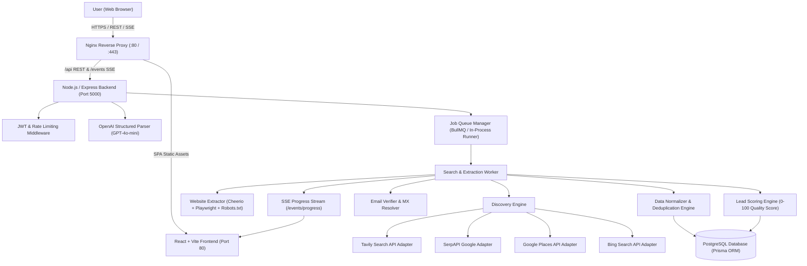

# AI LEAD FINDER — ARCHITECTURAL OVERVIEW

## System Components

1. **Frontend (React 18 + Vite + Tailwind CSS + Zustand)**:
   - High-contrast SaaS theme (Dark navy `#0B0F19`, slate, indigo).
   - Conversational AI Assistant & Step-by-Step 11-question wizard.
   - Real-time Server-Sent Events (SSE) live progress modal.
   - Filterable, sortable, paginated lead table with bulk actions and CSV/XLSX export.

2. **Backend API (Node.js + Express + TypeScript)**:
   - RESTful endpoints validated with Zod schemas.
   - Centralized authentication and role-based user isolation.
   - Dynamic SSE progress bus for live job monitoring.

3. **Multi-Source Discovery Engine**:
   - Modular independent adapters (`IDiscoveryProvider`) for Tavily, SerpAPI, Google Places, and Bing.
   - Unified normalized business record format.
   - Live connection diagnostics with latency testing.

4. **Website Extraction & Verification**:
   - Robots.txt compliance check before crawler dispatch.
   - HTML parsing with Cheerio and fallback for JS-heavy sites.
   - Extraction of company description, public business emails, telephone numbers, postal addresses, and LinkedIn company links.
   - DNS MX exchange lookup and third-party validation.

5. **Deduplication & Quality Scoring**:
   - Levenshtein and Jaro-Winkler string similarity ratios.
   - Multi-factor duplicate matching (domain, phone, company name + location, address).
   - Provenance preservation: field-level source attribution and lossless merging.
   - Itemized 0-100 quality scoring algorithm with itemized points breakdown.
